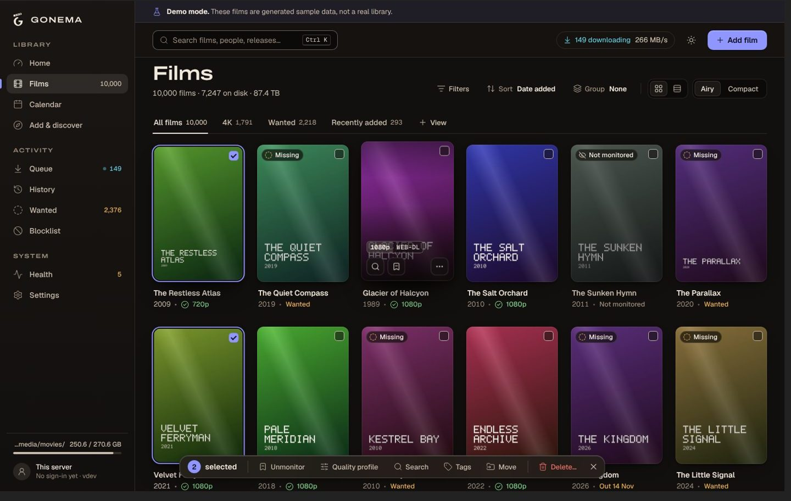
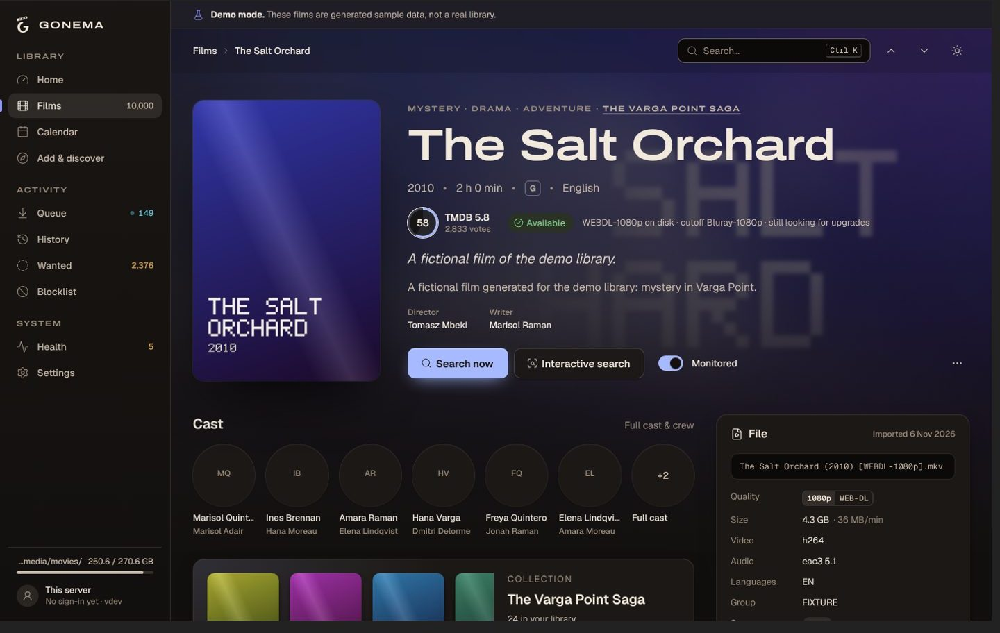
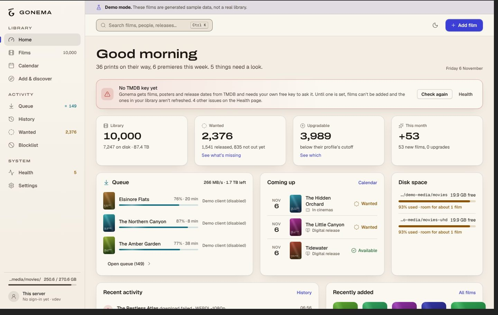
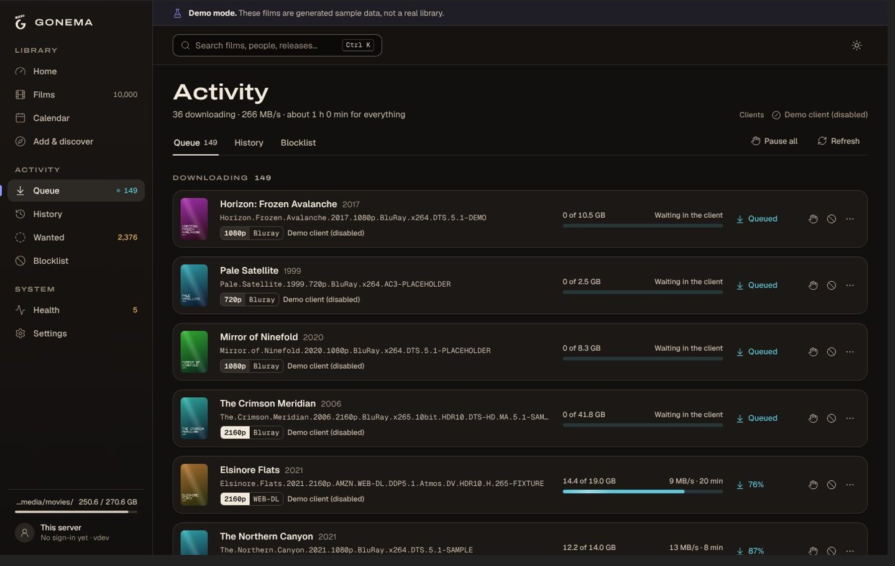

# Gonema

Gonema is a self-hosted manager for a movie collection. It watches the films you want, searches your Usenet and BitTorrent indexers, picks the best release according to quality rules you set, sends it to your download client, then imports, renames and files it in your library, and upgrades it later when a better release appears. Every automatic decision records its reasons in the history.

It is one static binary (Go, SQLite embedded, web interface embedded) or a small `scratch` Docker image. There is no hosted service: you run it on your own machine, NAS or server.

| Library | Film |
|---|---|
|  |  |
| **Home** | **Queue** |
|  |  |

The screenshots show the **demo mode** (`gonema demo seed`): fictional films with generated posters, flagged by a permanent banner. A real library shows your films with their TMDB artwork.

What it does today:

- Library: TMDB metadata (with your own free TMDB API key), collections, tags, saved views, calendar, command palette; 10,000 films stay fast.
- Indexers: Newznab and Torznab; download clients: SABnzbd, NZBGet, qBittorrent, Deluge, Transmission.
- Decisions: release-name parser, quality profiles with cutoff, custom scoring rules, upgrades, blocklist, failed-download handling; each accept/reject comes with its reasons.
- Import: hard link (seeding torrents), copy or move, naming templates, subtitles, recycle bin instead of deletion, remote path mapping, crash-safe import journal.
- Media servers (Plex, Jellyfin, Kodi) and notifications (webhook, Discord, Slack, Telegram, Pushover, ntfy, Gotify, e-mail).
- Operations: health checks, scheduled backups, restore, logs with secret redaction, account and API key authentication.

## Quick start

### Binary

Download the archive of your platform from the releases page (Linux, macOS, Windows; amd64, arm64; Linux armv7), check it against `checksums.txt`, extract it, then:

```sh
./gonema serve -data-dir ./data
```

Open <http://127.0.0.1:7676>. By default Gonema listens on the loopback only; add `-bind 0.0.0.0:7676` to reach it from the LAN.

From the sources (Go 1.27.3; Node 22.18+ for the web interface):

```sh
make release        # builds web/ then bin/gonema with the interface embedded
./bin/gonema serve
```

`make build` alone gives a binary that serves a placeholder page instead of the interface.

### Docker

```sh
docker run -d --name gonema -p 7676:7676 \
  --user 1000:1000 \
  -v /srv/gonema:/data \
  -v /srv/media:/media \
  ghcr.io/fs0ciety7000/gonema:latest
```

`/srv/gonema` must be writable by UID 1000. With qBittorrent and SABnzbd, start from [`docker-compose.example.yml`](docker-compose.example.yml): it explains the volume layout that keeps hard links working.

**PUID/PGID**: the image is built `FROM scratch` (no shell, no user database, nothing to switch users at start), so the `PUID`/`PGID` variables of other images do not apply. Choose the user with `user: "UID:GID"` in compose (or `--user`), and give that user the data folder and your media folders. Without `user:`, the image runs as `65532:65532`; a named volume is then initialised with the right owner, a bind-mounted folder must be `chown 65532:65532`.

The image holds the binary, the CA certificates and the time zone database (set `TZ`). Its health check runs `/gonema healthcheck` (there is no curl in `scratch`).

## First run

1. Open the web interface and **create the admin account** (first screen). Until it exists, anyone who reaches the instance can create it: do it before exposing Gonema. The setup shows an **API key once**, for scripts (header `X-Api-Key`); store it; `POST /api/v1/auth/api-key` replaces it later.
2. Add your TMDB API key (free, from themoviedb.org): Gonema uses your key, not a shared one.
3. Add a root folder (where films live), a download client and indexers, and the folders downloads can be imported from.
4. Add films, or import an existing library folder.
5. Back up `gonema.key` from the data directory somewhere safe (see [Backups](#backups-and-restore)).

`gonema demo seed -data-dir /tmp/gonema-demo` creates a separate demo instance with fictional films, to try the interface without indexers.

## Configuration

Flags or environment variables (a flag wins). Full table: [`docs/configuration.md`](docs/configuration.md).

| Variable | Flag | Default | |
|---|---|---|---|
| `GONEMA_DATA_DIR` | `-data-dir` | `./data` (image: `/data`) | database, master key, backups, cache, logs |
| `GONEMA_BIND` | `-bind` | `127.0.0.1:7676` (container: `0.0.0.0:7676`) | listen address |
| `GONEMA_BASE_URL` | `-base-url` | empty | sub-path behind a reverse proxy, e.g. `/gonema` |
| `GONEMA_WORKERS` | `-workers` | `4` | background job workers |
| `GONEMA_LOG_LEVEL` | `-log-level` | `info` | `debug`, `info`, `warn`, `error` (also changeable at runtime) |
| `GONEMA_LOG_FORMAT` | `-log-format` | `text` | `text` or `json` |
| `GONEMA_LOG_FILE` | `-log-file` | empty | rotating log file (relative: inside the data directory) |
| `GONEMA_LOG_MAX_SIZE_MB` / `GONEMA_LOG_KEEP` | `-log-max-size` / `-log-keep` | `10` / `5` | rotation |
| `GONEMA_LOG_BUFFER` | `-log-buffer` | `2000` | entries kept for the Logs screen |
| `GONEMA_AUTH` | `-auth` | `enabled` | `disabled_for_local`: no login for direct requests from loopback or private addresses (never for requests carrying proxy headers) |
| `GONEMA_COOKIE_SECURE` | `-cookie-secure` | `auto` | `auto`, `true`, `false`: `Secure` session cookie |
| `GONEMA_TRUSTED_ORIGINS` | `-trusted-origins` | empty | extra origins for the cross-site request check (proxy rewriting `Host`) |
| `GONEMA_OUTBOUND_ALLOW_LOOPBACK` | `-outbound-allow-loopback` | `true` | integrations may reach loopback |
| `GONEMA_OUTBOUND_ALLOW_PRIVATE` | `-outbound-allow-private` | `true` | integrations may reach the LAN |
| `GONEMA_WEBHOOK_ALLOW_PRIVATE` | `-webhook-allow-private` | `false` | webhooks may reach loopback and the LAN |
| `GONEMA_MASTER_KEY` | | unset | master key (base64) instead of the `gonema.key` file |

Security model and details: [`docs/security.md`](docs/security.md) (in French).

## Upgrading

Back up, replace the binary or pull the new image, start. Database migrations run at start. Downgrades are not supported: restore the pre-upgrade backup with the older version instead. Details: [`docs/operations.md`](docs/operations.md#upgrading).

## Backups and restore

- **Scheduled**: weekly by default, the newest 4 kept (`PUT /api/v1/settings/backups`).
- **Manual**: `POST /api/v1/backups`, or `gonema backup` on the command line.
- Archives are zip files in `<data dir>/backups/`: a consistent online copy of the database plus a manifest (Gonema version, schema version, date, checksum).
- **The master key `gonema.key` is not in the archives** unless you ask for it (`includeKey`, `-include-key`): the database stores your indexer keys and client passwords encrypted with it, and an archive holding both unlocks them. Keep one copy of `gonema.key` apart from the backups.
- **Restore**: `POST /api/v1/backups/restore` with `confirm: true`, or `gonema restore archive.zip`. The archive is validated, the current state is backed up first, and the database is swapped at the next start. Restart Gonema to apply it.

All of it, with the recovery of interrupted imports and the logs: [`docs/operations.md`](docs/operations.md).

## Reverse proxy

Gonema serves plain HTTP; put TLS on a reverse proxy. Things that matter:

- **Server-Sent Events**: `/api/v1/events` and `/api/v1/logs/stream` are long-lived streams. The proxy must not buffer them nor time them out quickly. Gonema sends `X-Accel-Buffering: no` and a comment every 15 seconds.
- **Secure cookie**: behind HTTPS, the session cookie must be `Secure`. With `GONEMA_COOKIE_SECURE=auto` (default) Gonema relies on `X-Forwarded-Proto: https` from the proxy; send it, or set `GONEMA_COOKIE_SECURE=true`.
- **Origin check**: if the proxy rewrites `Host`, list the public origin in `GONEMA_TRUSTED_ORIGINS`.
- **`GONEMA_AUTH=disabled_for_local`** does not open the instance to the proxy's clients: requests carrying proxy headers always need a login.
- Bind Gonema to `127.0.0.1` (or a private Docker network) so only the proxy reaches it.

### Caddy

```caddyfile
media.example.org {
	reverse_proxy 127.0.0.1:7676 {
		flush_interval -1
	}
}
```

Caddy sets `X-Forwarded-Proto` and does not buffer event streams; `flush_interval -1` makes it explicit.

### nginx

```nginx
server {
    listen 443 ssl;
    server_name media.example.org;
    # ssl_certificate ...;

    client_max_body_size 4g;            # backup uploads

    location / {
        proxy_pass http://127.0.0.1:7676;
        proxy_http_version 1.1;
        proxy_set_header Host $host;
        proxy_set_header X-Forwarded-For $proxy_add_x_forwarded_for;
        proxy_set_header X-Forwarded-Proto $scheme;
        proxy_set_header Connection "";
        proxy_buffering off;            # Server-Sent Events
        proxy_read_timeout 1h;
    }
}
```

Under a sub-path, use `location /gonema/ { proxy_pass http://127.0.0.1:7676; ... }` and start Gonema with `-base-url /gonema`.

### Traefik

```yaml
services:
  gonema:
    image: ghcr.io/fs0ciety7000/gonema:latest
    labels:
      - traefik.enable=true
      - traefik.http.routers.gonema.rule=Host(`media.example.org`)
      - traefik.http.routers.gonema.entrypoints=websecure
      - traefik.http.routers.gonema.tls.certresolver=letsencrypt
      - traefik.http.services.gonema.loadbalancer.server.port=7676
```

Traefik streams responses without buffering by default and sets `X-Forwarded-Proto`. Do not add the `buffering` middleware to this router; if you use the `compress` middleware, exclude `text/event-stream` (`excludedContentTypes`).

## Hard links and path mapping

- A torrent that keeps seeding is **hard linked** into the library: no extra space, the client keeps its file. A hard link works only inside one file system. Put downloads and the library on the same disk, and in Docker mount their **common parent** once (`/srv/media:/media`), not two separate volumes, or Gonema falls back to a copy.
- Usenet downloads are **moved** (or copied, per setting).
- **Remote path mapping**: when the download client sees a path that Gonema sees elsewhere (client in another container or host, `/downloads/complete` there, `/media/downloads/complete` here), add a mapping in Settings > Download clients. Mounting the same host folder at the same path in every container avoids mappings altogether.
- Gonema reads only from the folders you allow as import folders, never overwrites a file, and sends replaced or deleted files to a recycle bin; emptying it is always your decision.

## Troubleshooting

| Symptom | Look at |
|---|---|
| The web page shows a placeholder | the binary was built without `make web`: use a release build or `make release` |
| `401` on every API call from a script | send the API key in the `X-Api-Key` header (never in the URL: refused) |
| Logged out at once behind HTTPS, or login loops | cookie `Secure` mismatch: proxy must send `X-Forwarded-Proto`, or set `GONEMA_COOKIE_SECURE` |
| `403` on changes behind a proxy | origin check: add the public origin to `GONEMA_TRUSTED_ORIGINS` |
| Live updates stop, the queue does not move | the proxy buffers Server-Sent Events: see [Reverse proxy](#reverse-proxy) |
| Imports copy instead of hard linking | downloads and library on different file systems or different Docker mounts |
| "Permission denied" in the container | the `user:` UID/GID cannot write `/data` or the media folders |
| An integration on the LAN is refused | `GONEMA_OUTBOUND_ALLOW_PRIVATE` / `_LOOPBACK`; webhooks to the LAN need `GONEMA_WEBHOOK_ALLOW_PRIVATE=true` |
| Secrets unreadable after a restore or a move | the master key changed: restore `gonema.key`, or enter the secrets again |
| A health issue "An import was interrupted" | check the two paths it names, then dismiss it ([operations](docs/operations.md#crash-recovery-of-imports)) |
| Need more detail | `PUT /api/v1/settings/logs {"level":"debug"}`, then `GET /api/v1/logs/download` (secrets are redacted) |

## Development

`make test`, `make lint`, `make build`, `make bench`; see [`AGENTS.md`](AGENTS.md) and [`docs/architecture.md`](docs/architecture.md).

## License

GPL-3.0. See [LICENSE](LICENSE).
