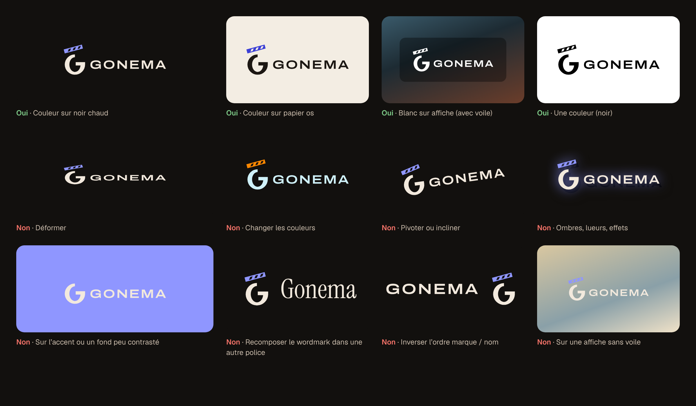

# Gonema — charte de marque (v1.0)

> Direction retenue : **A « Salle »** (marque, palette, accent outremer, ton, mascotte au trait) avec la **typographie de B** (Archivo Expanded, Geist, Geist Mono). Les directions explorées restent dans `docs/brand/directions/` pour l'historique.
> Source unique des valeurs : `tokens.json` (et `tokens.css`, généré). Planche visuelle : `index.html` / `overview.png`.

## 1. Positionnement

- **Promesse** : une salle de cinéma privée pour votre collection ; Gonema choisit la meilleure copie et vous dit pourquoi.
- **Personnalité** : cultivée, calme, transparente. Un humour de projectionniste, sec et bref.
- **Ce que Gonema n'est pas** : un panneau d'administration, un « Hollywood » doré, un outil de hacker néon.

## 2. Logo

### Éléments
- **Marque** : le G-ardoise (contraste vertical, flancs pleins, déliés en haut et en bas) surmonté du bras du clap ouvert à 15°, trois rayures. Le G est l'ardoise, le bras est le geste « action ».
- **Wordmark** : « GONEMA » en Archivo, largeur 125 (Expanded), graisse 600, approche +8 %, vectorisé (aucune police requise).
- **Lockups** : horizontal (usage par défaut : en-tête, README, documentation) et empilé (écrans d'accueil, splash, carrés).

Fichiers dans `logo/` : `mark-*`, `wordmark-*`, `lockup-horizontal-*`, `lockup-stacked-*`, chacun en `on-dark`, `on-light`, `black`, `white`, `currentcolor` (hérite de `color` en CSS, idéal pour l'UI).

### Choix de la casse et ajustement de la marque
- **Capitales** retenues plutôt que « Gonema » en bas de casse : en bas de casse, le G du wordmark répète celui de la marque avec un dessin différent (deux G qui se contredisent). Les capitales élargies lisent comme un carton de générique, gardent un gris typographique régulier et laissent la marque porter la seule courbe expressive.
- **Graisse 600** : la 500 paraît frêle à côté des flancs du G, la 700 l'écrase.
- **Marque ajustée** : les déliés du G passent de 16 à 22 unités (sur 256) ; les flancs restent à 36. Le contraste didone d'origine (16/36) se heurtait à la grotesque monolinéaire ; à 22/36 l'idée « ardoise à contraste » reste lisible et le couple marque + Archivo est cohérent. Le bras, l'angle (15°) et les rayures ne changent pas.

### Zone de protection
`X` = hauteur de capitale du wordmark dans le lockup (≈ ¼ de la hauteur de la marque). Laisser au moins `X` de vide sur chaque côté du lockup ; pour la marque seule, `X` = ¼ de sa hauteur. Voir `renders/clear-space.png`.

### Tailles minimales
| Élément | Écran | Impression |
|---|---|---|
| Lockup horizontal | 32 px de haut | 10 mm |
| Lockup empilé | 64 px de haut | 18 mm |
| Marque seule | 24 px | 7 mm |
| Wordmark seul | 12 px de haut | 4 mm |
| Sous 24 px | utiliser le **favicon dédié** (`icons/favicon-16.svg`, `icons/favicon.svg`) | — |

### Fonds autorisés
Noir chaud `#12100E`, papier os `#F3EDE3`, blanc, et les affiches **avec voile** (≥ 35 % de noir) en version blanche. Jamais sur l'accent ni sur un fond peu contrasté.

### À faire / à ne pas faire


Ne pas : déformer, changer les couleurs, pivoter, ajouter ombres ou lueurs, poser sur l'accent, recomposer le nom dans une autre police, inverser l'ordre marque/nom, poser sur une affiche claire sans voile.

## 3. Icônes

`icons/` contient : `favicon.ico` (16, 32, 48 ; le 16 vient du dessin dédié à 16 px), `favicon.svg` (dessin 32 px, deux rayures), `favicon-16.svg`, `apple-touch-icon.png` (180, fond plein, iOS arrondit lui-même), `icon-192.png` / `icon-512.png` (tuile arrondie), `icon-maskable-192.png` / `icon-maskable-512.png` (fond plein, marque dans la zone sûre de 80 %), `site.webmanifest`, `head-snippet.html`.
Test en contexte d'onglet : `renders/tab-context-1x.png` (vrais 16 px) et `renders/tab-context-2x.png`.

## 4. Couleur

| Rôle | Sombre (défaut) | Clair | Usage |
|---|---|---|---|
| bg-base | `#12100E` | `#F3EDE3` | fond de l'application |
| bg-raised | `#1C1815` | `#FBF8F2` | cartes, barres latérales, menus |
| surface-glass | `#2A231E` @ 72 % | `#FFFDF9` @ 70 % | couches translucides (flou 20 px) au-dessus des affiches |
| border | `#F2E8DC` @ 12 % | `#2A2018` @ 14 % | filets décoratifs uniquement |
| text-primary | `#F2E9DD` | `#1C1713` | titres, texte courant |
| text-secondary | `#C9BBAB` | `#4E443B` | libellés, texte d'appoint |
| text-muted | `#9C8D7D` | `#6E6257` | métadonnées (≥ 12 px, graisse ≥ 400) |
| accent | `#8F96FF` | `#3B3FD6` | action principale, focus, sélection, liens |
| accent-contrast | `#0E0C1F` | `#FFFFFF` | texte sur l'accent |
| status-downloading | `#5EC4D6` | `#0B6E80` | en cours |
| status-missing | `#E8AE55` | `#8C5300` | surveillé, absent du disque |
| status-upgraded | `#D69AEA` | `#86389F` | remplacé par une meilleure copie |
| status-failed | `#F27268` | `#B42A22` | échec |
| status-available | `#7FCC89` | `#2B7236` | présent, seuil atteint |

**Règles**
- **L'accent est rare** : au plus un élément plein en accent par vue (le bouton principal) ; ailleurs, liens et anneau de focus. Jamais de grandes surfaces d'accent, jamais l'accent comme couleur de statut.
- Les couleurs de statut s'accompagnent **toujours** d'une icône ou d'un libellé (jamais la couleur seule). Badge type : texte de statut sur une teinte à 14 % de la même couleur.
- Focus : anneau 2 px d'accent, décalé de 2 px (`--focus-ring`).
- Les noirs restent chauds : ne jamais utiliser de gris neutres (`#111`, `#1E1E1E`…).

**Contraste mesuré (WCAG 2.1, minimum sur bg-base / bg-raised / verre)** — tous ≥ 4,5:1 :

| Rôle | Sombre | Clair |
|---|---|---|
| text-primary | 13.74 | 15.27 |
| text-secondary | 8.79 | 8.15 |
| text-muted | 5.13 | 5.08 |
| accent (texte, focus) | 6.27 | 6.29 |
| accent-contrast sur accent | 7.31 | 7.32 |
| downloading | 8.13 | 5.07 |
| missing | 8.35 | 5.38 |
| upgraded | 7.60 | 5.86 |
| failed | 5.80 | 5.47 |
| available | 8.57 | 5.06 |
| badge (statut sur sa teinte 14 %), le plus faible | 5.03 (failed) | 4.57 (downloading) |

Le verre est mesuré superposé sur bg-base ; au-dessus d'une affiche claire, ajouter un voile pour tenir ces ratios.

## 5. Typographie

| Rôle | Police | Licence |
|---|---|---|
| Titres (display) | **Archivo**, axe `wdth` 125 (Expanded), 500 à 700 | SIL OFL 1.1 |
| Interface | **Geist** | SIL OFL 1.1 |
| Données (releases, chemins, scores, journaux) | **Geist Mono** | SIL OFL 1.1 |

Toutes disponibles sur Google Fonts, utilisables en logo, en UI et en auto-hébergement (embarquer les fichiers dans le binaire : l'OFL l'autorise, sans vendre la police seule).

**Échelle** (taille / interligne, graisse, approche) — détail dans `tokens.json` :
- display-2xl 64/68 · 600 · −0.02em ; display-xl 48/52 · 600 · −0.015em ; display-lg 36/40 · 600 · −0.01em ; display-md 28/34 · 600 · −0.005em
- overline 11/16 · Archivo 600 · +0.12em · capitales
- title-lg 20/28 · 600 ; title-md 16/24 · 600 ; body-lg 16/24 ; body 14/20 ; body-sm 13/18 ; caption 12/16 · 500
- mono 13/20 ; mono-sm 12/16

**Chiffres** : `font-variant-numeric: tabular-nums` partout où des nombres s'alignent (tailles, durées, scores, files) ; Geist Mono est tabulaire par construction. Pas de graisse < 400 sous 16 px. Les titres de films s'écrivent en casse de titre, pas en capitales.

## 6. Mascotte « Kernel »

Gopher original au trait d'encre : corps en poire assis, petits yeux rapprochés, bajoues, deux petites incisives, pelage os. Trait de contour 4, détails 3 (sur sa grille de 240 × 300). Il **n'est pas** le gopher Go de Renée French (CC BY 4.0) : ni bleu cyan, ni corps haricot, ni grands yeux écartés ; aucune proportion reprise.

Poses (`mascot/`) : `neutral`, `welcome` (onboarding), `empty-library` (lampe torche), `404` (derrière le rideau), `failed-download` (pellicule déchirée).

**Où il peut apparaître** : états vides, onboarding, 404, page d'erreur d'un téléchargement (vue détaillée), écran « tout est à jour ». **Où il n'apparaît pas** : à côté du logo ou à sa place, dans les tableaux, les notifications, la barre de navigation, les dialogues de confirmation destructive. Une seule mascotte par écran, jamais plus grande que 240 px de haut, jamais animée en boucle.

## 7. Voix et ton

Calme, transparent, court. Le vocabulaire de la salle (séance, copie, bobine, cabine) en touche légère ; une seule plaisanterie par écran au maximum, jamais dans un message d'erreur qui demande une action. Toujours dire **ce qui s'est passé** et **ce que Gonema fait ensuite**.

Exemples (UI en anglais) :
- Bibliothèque vide : « The house is dark. Add a film and we'll start the screening. »
- 404 : « This reel isn't in the booth. Back to the programme? »
- Échec de téléchargement : « The print arrived damaged. Blocklisted it, trying the next release. »
- Upgrade réussi : « New print: 1080p → 2160p Remux. Same seat, better picture. »
- Décision rejetée : « Skipped: 720p is below your cutoff (1080p). »
- Health check : « Indexer NZBgeek hasn't answered for 10 minutes. Others keep searching. »

À éviter : points d'exclamation en série, « Oops! », jargon sans explication, majuscules criardes, emoji.

## 8. Fichiers

```
docs/brand/kit/
├── guidelines.md      ← ce document
├── index.html         ← planche de marque (overview.png = capture)
├── tokens.json        ← source unique (couleurs, contrastes, typo, focus, rayons, ombres)
├── tokens.css         ← variables CSS (sombre par défaut, [data-theme], prefers-color-scheme)
├── logo/              ← marque, wordmark, lockups × 5 variantes
├── icons/             ← favicon.ico/svg, apple-touch, PWA, manifest, snippet <head>
├── mascot/            ← Kernel, 5 poses
└── renders/           ← PNG de contrôle (lockups, tailles, onglet, zone de protection, do/don't, mascotte)
```

Nom « Gonema » : recherche d'antériorité sommaire sans résultat (web, GitHub). Ce n'est pas une vérification juridique ; faire une recherche de marques (INPI, EUIPO, USPTO) avant lancement public.
